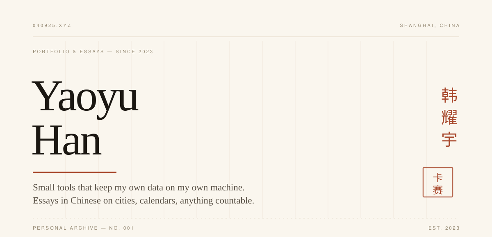

<picture>
  <source media="(prefers-color-scheme: dark)" srcset="assets/hero-dark.svg">
  
</picture>

I build small tools that keep my own data on my own machine, and I write about cities, calendars, and anything else that can be counted. Computer science, Shanghai Maritime University, 2026.

Most of what I make starts as a private annoyance. A relationship I could not remember clearly enough became an archive. A subscription I could not price honestly became a tracker. None of it feels finished, so I keep editing it.

<picture>
  <source media="(prefers-color-scheme: dark)" srcset="assets/band-01-dark.svg">
  
</picture>

- **[Ties](https://www.040925.xyz/projects/Ties/)** — a private archive of the people in my life: facts, timelines, search. Vue · 2026
- **Asset tracker** — what everything I own actually costs me per day. Tauri 2 · 2026
- **[kasai-space](https://www.040925.xyz/now/)** — this site, with its own Git-backed admin panel. Astro · 2025 –
- **Campus resources** — course material across roles, with a teaching assistant. Django · 2025

<picture>
  <source media="(prefers-color-scheme: dark)" srcset="assets/band-02-dark.svg">
  
</picture>

- **Is a longer metro really a stronger economy?** — 43 cities, ρ = 0.870, and why the rankings disagree.
- **How big is a 70B model, actually** — what 140 / 70 / 35 GB of weights do to one 80 GB card.
- **Make the skeleton first, then make it good** — on shipping the real structure before the polish.

Off screen

I keep a small library of things that reward cleaning: city rankings across 350 cities, holiday and make-up workday rules from 2021 to 2036, and twelve zodiac figurines traced back to museum collections.

I also play League of Legends and CS2, and far too much Esports Manager 2026. Formative television: Peaky Blinders, Breaking Bad, Better Call Saul, Narcos, Prison Break.

---

Vue · TypeScript · Astro · Django · Git &nbsp;·&nbsp; [040925.xyz](https://www.040925.xyz) &nbsp;·&nbsp; [Instagram](https://www.instagram.com/yaozenx)
